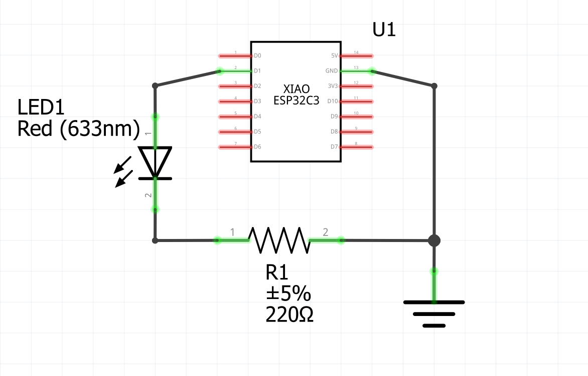
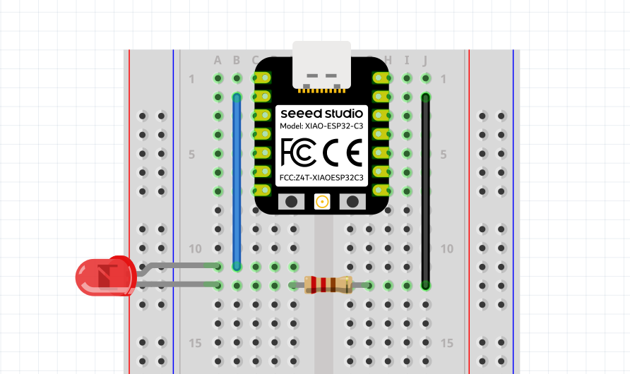

# 137. Brochage et périphérique de sortie numérique {#chapitre-premier_peripherique_sortie_del}

## 137.1 Brochage et types de broches

Le plan de brochage (pinout) indique l'emplacement des broches sur la carte, leurs noms et les fonctions qu'elles peuvent assurer. Les noms imprimés sur la carte, comme D1, ne sont pas nécessairement les numéros GPIO utilisés dans ESPHome : sur le XIAO ESP32-C3, D1 correspond à GPIO3.

{ width="900" }

Les broches n'ont pas toutes le même rôle :

* **Alimentation** : 3V3 fournit l'alimentation et GND est la masse; ce ne sont pas des GPIO.
* **GPIO numériques** : peuvent être configurés en entrée ou en sortie numérique, sous réserve des limites électriques de la carte.
* **Entrées analogiques (ADC)** : mesurent une tension; toutes les GPIO n'offrent pas cette fonction.
* **Fonctions périphériques** : certaines broches peuvent aussi servir aux bus comme I2C, SPI ou UART, ou produire un signal PWM. Ces fonctions sont partagées avec les rôles GPIO et leur disponibilité dépend de la carte.

### Broches de strapping

Sur l'ESP32-C3, GPIO2, GPIO8 et GPIO9 sont des broches de strapping. Leur niveau électrique est lu au démarrage pour déterminer certaines options de démarrage. Un circuit raccordé à l'une de ces broches qui impose un niveau incompatible peut empêcher le démarrage normal ou faire démarrer la carte dans un mode différent. Elles peuvent avoir d'autres usages après le démarrage, mais il faut tenir compte de cette contrainte lors du câblage. Pour les premières expériences, choisir une broche disponible qui n'est pas une broche de strapping.

## 137.2 Périphérique de sortie numérique : une DEL

### Montage électrique {#fiche-montage_electrique}

Une broche configurée comme sortie peut commander un périphérique simple. Pour ce premier montage, l'ESP32-C3 allumera et éteindra une DEL.

Utiliser une broche de sortie disponible sur le modèle exact de carte. Pour le XIAO ESP32-C3, D1 correspond à GPIO3; vérifier le brochage ci-dessus avant de câbler.

{ width="800" }
{ width="800" }

La patte longue de la DEL est l'anode et la patte courte, près du côté plat du boîtier, la cathode. La résistance doit être en série avec la DEL. Ne jamais brancher une DEL directement entre une broche et GND. 

### Déclarer la sortie dans ESPHome

Ajouter un interrupteur GPIO à la configuration :

```yaml
switch:
  - platform: gpio
    pin: GPIO3 # À remplacer par la broche choisie pour la DEL
    id: led_montage
    name: "DEL du montage"
```

Après compilation et installation, cet interrupteur devrait être disponible dans Home Assistant (section *Contrôles*). L'état activé applique un niveau logique haut à la broche; si la DEL est branchée avec la polarité indiquée, elle s'allume.

Ajouter le contrôle de votre DEL à un tableau de bord Home Assistant.

### Vérifications et précautions

1. Vérifier le câblage hors tension avant de connecter la carte.
2. Confirmer que la broche choisie correspond au numéro GPIO de la configuration, et pas seulement au nom imprimé sur la carte.
3. Si la DEL ne s'allume pas, vérifier sa polarité, la résistance, la connexion GND et la broche dans les journaux.

## Références

* [Interrupteur GPIO ESPHome](https://esphome.io/components/switch/gpio/)
* [Plan de brochage du XIAO ESP32-C3 (Seeed Studio)](https://files.seeedstudio.com/wiki/XIAO_WiFi/XIAO_ESP32-C3_front_pinout.png)
* [Mode de démarrage et broches de strapping de l'ESP32-C3 (Espressif)](https://docs.espressif.com/projects/esp-idf/en/stable/esp32c3/api-guides/boot-mode-selection.html)