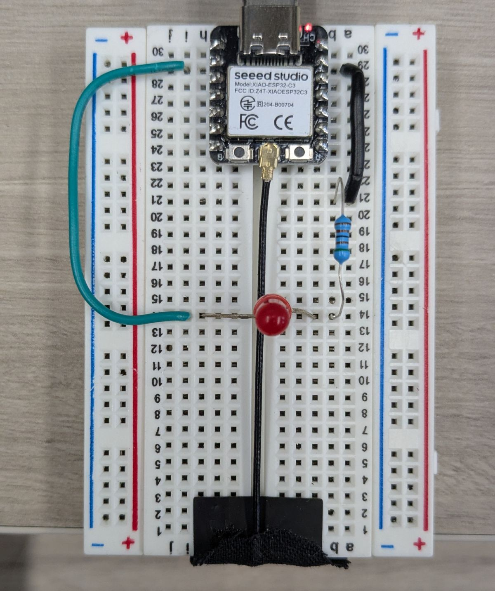

# 138. Exercice : commander une DEL avec ESPHome {#chapitre-exercice_premier_peripherique_sortie_del}

## 138.1 Travail demandé {#fiche-travail_demande}

Réalisez le premier périphérique de sortie avec le XIAO ESP32-C3.

{ width="400" }

1. À partir du schéma de la fiche précédente et de la photo ci-dessus, câbler une DEL avec une résistance en série et une broche GND.
2. Ajouter à la configuration ESPHome un interrupteur GPIO correspondant à la broche utilisée. Vérifier le numéro GPIO sur le brochage du XIAO ESP32-C3.
3. Compiler et installer le micrologiciel. Vérifier que l'interrupteur apparaît dans Home Assistant.
4. Commander la DEL depuis Home Assistant et vérifier visuellement les états activé et désactivé.
5. Ajouter le contrôle de la DEL à un tableau de bord Home Assistant.
6. Créer un script Home Assistant qui allume la DEL pendant 1 seconde, puis l'éteint pour 1 seconde, et répète cette séquence 5 fois. Ajouter ce script à un tableau de bord et vérifier son fonctionnement.
5. En cas de problème, vérifier la polarité de la DEL, le câblage, la broche déclarée et les journaux ESPHome.
