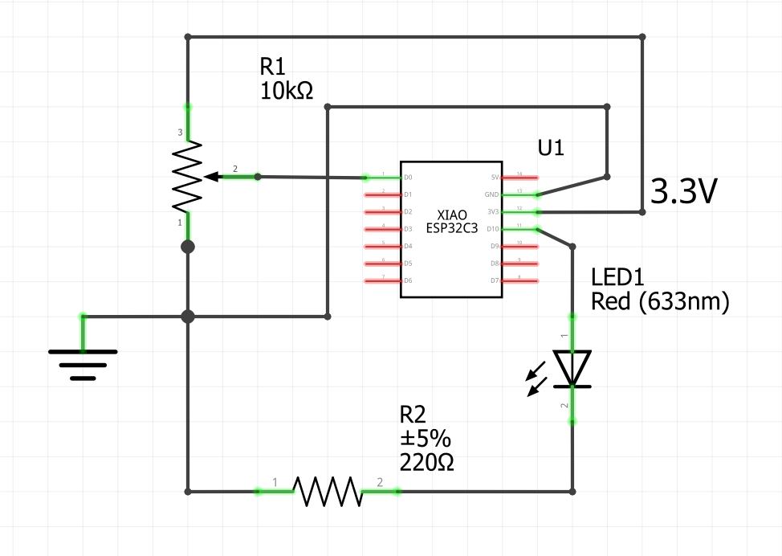
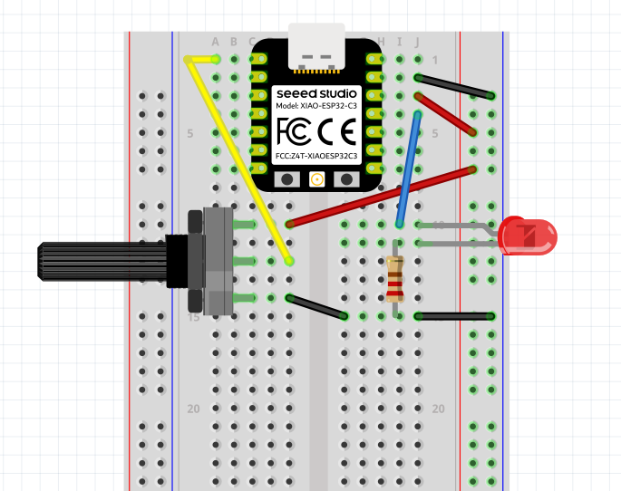

# 142. Exercice : régler la luminosité avec un potentiomètre {#chapitre-exercice_del_pwm_potentiometre_esphome}

## 142.1 Travail demandé {#fiche-travail_demande}

Effectuer le montage suivant avec commande de luminosité PWM et un potentiomètre.

---

1. Hors tension, brancher la DEL avec sa résistance en série sur une broche de sortie compatible.
1. Brancher les bornes extérieures du potentiomètre à 3,3 V et GND; connecter son curseur à une broche ADC compatible.
1. Vérifier le brochage du XIAO ESP32-C3 et confirmer que la broche de la DEL et celle du potentiomètre sont différentes.
1. Déclarer une sortie `ledc` et une lumière monochrome, puis compiler et vérifier que la commande de luminosité apparaît dans Home Assistant.
1. Déclarer le potentiomètre avec le capteur ADC. Observer et noter les valeurs minimales et maximales dans les journaux ou Home Assistant.
1. Associer la valeur ADC à la luminosité de la DEL avec une action `on_value`. Convertir la plage mesurée en valeur comprise entre 0 et 1; éviter que la valeur sorte de cette plage.
1. Tourner lentement le potentiomètre et vérifier que la luminosité suit le mouvement. Comparer ensuite avec le réglage depuis Home Assistant.

## Remise

Remettre le YAML sans secrets, un schéma indiquant les broches, les valeurs ADC minimale et maximale relevées, ainsi qu'une courte comparaison entre le réglage local et celui de Home Assistant.

## Critères de réussite

* La DEL est commandée par une sortie PWM avec une résistance en série.
* La position du potentiomètre est publiée comme mesure ADC.
* La plage ADC mesurée est convertie en luminosité sans appliquer plus de 3,3 V à une entrée.
* La luminosité varie avec le potentiomètre et peut aussi être réglée depuis Home Assistant.