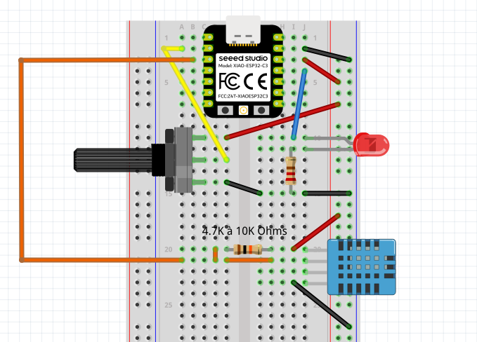
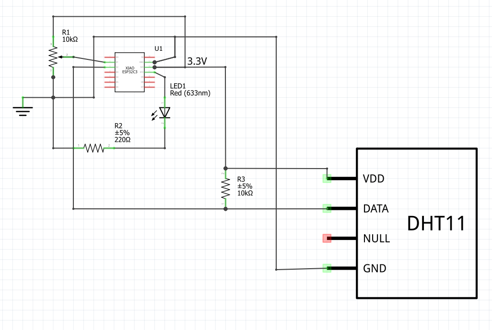

# 149. Exercice 8 : température, bouton, potentiomètre et DEL {#chapitre-exercice_capteur_temperature_esphome}

## 149.1 Travail demandé {#fiche-travail_demande}

À partir de l'appareil ESPHome développé dans les exercices précédents, intégrer un capteur de température externe au montage bouton-DEL-potentiomètre. La température doit apparaître dans Home Assistant et déclencher une automatisation à seuil.

1. Faire une copie de la configuration de l'appareil. Vérifier que le capteur fourni est un DHT11 et consulter son brochage et la documentation ESPHome avant de le brancher.
1. Hors tension, repérer les quatre broches du DHT11. Sur le boîtier classique, grille face à soi et broches vers le bas, l'ordre est généralement VCC, DATA, NC, GND; laisser NC inutilisée. Brancher VCC à 3,3 V, GND à la masse et DATA à `GPIO4`. Le module fourni possède déjà sa résistance de rappel entre DATA et 3,3 V; ne pas en ajouter une autre. Si son brochage diffère, suivre son marquage et sa fiche technique.
1. Ajouter le DHT11 à la configuration ESPHome avec `platform: dht`, `model: DHT11` et un intervalle de lecture de 10 secondes. Pour la broche, reprendre la configuration `GPIO4` de la fiche de cours avec `pullup: false`, puisque la résistance externe est déjà sur le module. Déclarer la mesure de température; ajouter aussi l'humidité si désiré. Réutiliser le bloc `sensor:` existant plutôt que d'en créer un second.
1. Compiler la configuration. Corriger les erreurs avant d'installer le micrologiciel; consulter les journaux pour confirmer que le capteur publie une température plausible.
1. Vérifier les fonctions déjà étudiées : le bouton commande la DEL et le potentiomètre règle son intensité. Tester le comportement lorsque la DEL est éteinte puis que le potentiomètre bouge; si la configuration rallume la DEL, ajuster l'action du potentiomètre pour qu'elle règle l'intensité seulement lorsque la lumière est allumée.
1. Ajouter l'entité de température et les entités utiles du bouton, de la lumière et du potentiomètre à une vue du tableau de bord Home Assistant.
1. Créer une automatisation Home Assistant avec un déclencheur **État numérique** sur la température, par exemple lorsqu'elle franchit vers le haut une limite proche de la température ambiante, puis commander la DEL. Choisir un seuil réaliste pour le capteur et la séance.
1. Pour vérifier le retour, créer une seconde automatisation qui éteint la DEL sous une limite plus basse que le seuil d'allumage. Cette différence entre les limites constitue une hystérésis.
1. Vérifier les traces de l'automatisation et les journaux ESPHome. Si la température ne franchit pas les limites pendant la séance, vérifier la configuration et la trace sans chauffer rapidement le capteur ni dépasser les limites de sa fiche technique.
1. Comparer la température ambiante avec `internal_temperature` si cette entité est disponible. Expliquer pourquoi ces valeurs ne mesurent pas la même chose et noter ce qui dépend de Home Assistant.