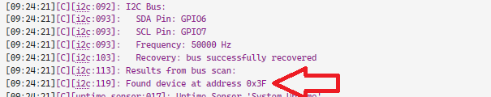
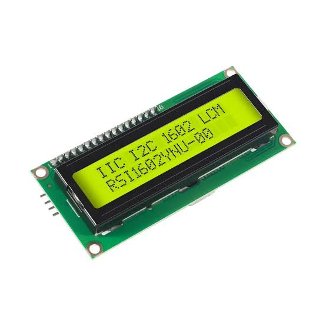
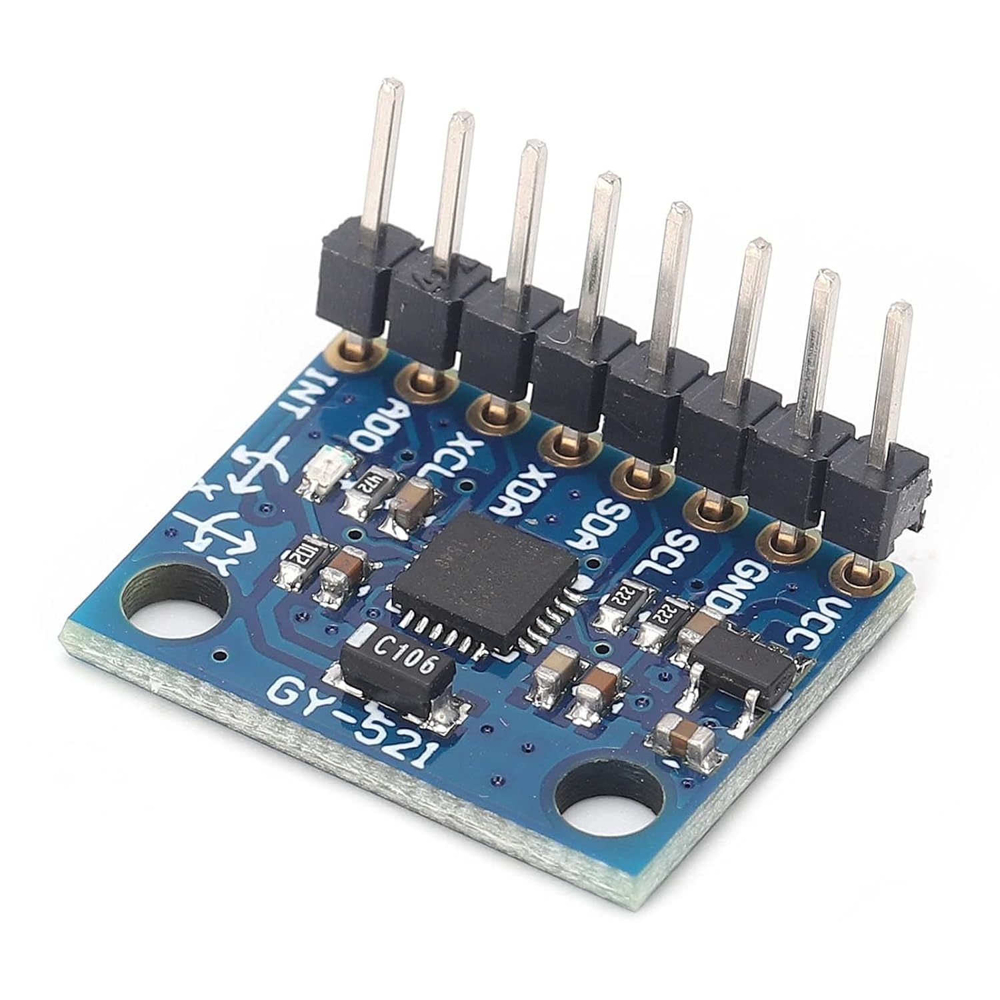

# 150. Bus I²C, écran LCD et MPU6050 avec ESPHome {#chapitre-bus_i2c_esphome}

## 150.1 Comprendre le bus I²C

I²C (« Inter-Integrated Circuit ») est un bus série synchrone qui permet à un microcontrôleur de communiquer avec plusieurs composants en utilisant deux lignes communes :

* **SDA** transporte les données;
* **SCL** fournit le signal d'horloge qui synchronise leur transfert.

L'ESP32-C3 joue le rôle de contrôleur : il initie les échanges. Les périphériques, comme un afficheur ou un capteur, sont raccordés aux mêmes lignes SDA et SCL. Les fils peuvent être distribués en parallèle ou d'un module au suivant. Tous les composants doivent partager une masse commune.

Les lignes I²C sont de type « collecteur ouvert » : les appareils peuvent ramener une ligne à l'état bas, mais ne la forcent pas à l'état haut. Des résistances de rappel (*pull-up*) ramènent donc SDA et SCL à l'état haut lorsqu'aucun appareil ne les maintient à l'état bas. Elles sont souvent déjà présentes sur les modules. Vérifier le montage avant d'en ajouter, et vérifier que les résistances ramènent les lignes à une tension compatible avec l'ESP32-C3.

!!! Attention
    Certains modules alimentés en 5 V peuvent aussi tirer SDA et SCL vers 5 V, ce qui n'est pas sécuritaire pour les entrées de l'ESP32-C3.

## 150.2 Adresses des périphériques

Quand le contrôleur veut communiquer avec un périphérique, il envoie une adresse sur SDA, synchronisée par SCL. Tous les périphériques du bus observent cette adresse, mais seul celui qui la reconnaît répond par un acquittement (*ACK*). Les données sont ensuite échangées; le bit de lecture ou d'écriture indique le sens de l'opération.

La plupart des configurations et des outils présentent l'adresse I²C sur 7 bits, en hexadécimal, par exemple `0x27` ou `0x3C`. Le bit de lecture/écriture (bit 8) fait partie du transfert sur le fil; il ne faut pas l'ajouter à l'adresse fournie à ESPHome.

Un appareil peut parfois offrir plusieurs adresses sélectionnables par des cavaliers (*jumpers*) ou des broches. Deux appareils ayant la même adresse sur un même bus peuvent entrer en conflit; il faut alors changer l'adresse d'un des modules, utiliser un multiplexeur I²C ou les placer sur des bus distincts.

Pour un LCD1602 équipé d'un adaptateur I²C PCF8574, les adresses courantes sont `0x27` et `0x3F`. Il s'agit de l'adresse de l'adaptateur, pas de l'écran à caractères lui-même. Ne pas choisir une adresse au hasard : vérifier celle détectée par le balayage et la documentation du module.

## 150.3 Balayer le bus au démarrage avec ESPHome

La section `i2c:` configure le bus et les broches. Avec `scan: true`, ESPHome recherche au démarrage les adresses qui répondent et inscrit celles trouvées dans les journaux. Le balayage est activé par défaut, mais le préciser rend l'intention claire :

```yaml
i2c:
  sda: GPIO6
  scl: GPIO7
  scan: true
```

Pour le XIAO ESP32-C3 utilisé dans le cours, le diagramme de brochage associe SDA à `GPIO6` et SCL à `GPIO7`. ESPHome permet de choisir d'autres broches compatibles, mais conserver ce câblage et cette configuration facilite le suivi du montage. Vérifier que GPIO6 et GPIO7 ne sont pas déjà utilisées par un autre composant. Si la configuration contient déjà une section `i2c:`, compléter celle-ci plutôt que d'en créer une deuxième.

Au démarrage, le scanner essaie des adresses sur le bus. Lorsqu'un périphérique répond, les journaux ESPHome affichent son adresse, par exemple `0x27`. Chaque module relié au bus peut apparaître avec sa propre adresse. Ces résultats permettent de vérifier qu'un appareil répond et de connaître l'adresse à configurer dans son composant ESPHome.




Le balayage n'identifie **pas** le type de périphérique et ne vérifie pas que son pilote, son écran ou son capteur fonctionne correctement. Il indique seulement qu'une adresse a répondu. L'absence d'adresse peut venir des broches, des fils, de l'alimentation, de la masse commune, des résistances de rappel, d'une incompatibilité de tension ou d'un module défectueux. Corriger le branchement, redémarrer l'appareil et consulter de nouveau les journaux.

## 150.4 Configuration d'un LCD1602



Un LCD1602 est un écran à caractères de 16 colonnes × 2 lignes. Lorsqu'il est muni d'un adaptateur I²C PCF8574, il demande deux niveaux de configuration : la section `i2c:` pour le bus, puis la plateforme d'affichage. On peut créer une entité texte ESPHome que Home Assistant peut modifier. L'écran affiche cette valeur; il n'est pas lui-même une entité de commande Home Assistant.

!!! Attention
    L'écran disponible en classe fonctionne en 5 V, tandis que les entrées/sorties du XIAO ESP32-C3 sont à 3,3 V. Cette partie sert à comprendre le câblage et la configuration; le LCD ne fait pas l'objet d'un exercice. Avant tout branchement, vérifier la tension d'alimentation et les niveaux logiques du module. Ne jamais relier au ESP32-C3 un signal ou une ligne I²C tirée à 5 V; utiliser un convertisseur de niveau compatible si nécessaire.

Dans cet exemple, le scanner a trouvé `0x27`. `text:` avec `platform: template` crée une entité texte virtuelle et modifiable depuis Home Assistant. On l'utilise pour recevoir le texte saisi dans Home Assistant et le transmettre à la lambda de l'écran. Ce n'est pas un texte lu depuis un capteur physique; `text_sensor:` sert plutôt à publier du texte en lecture seule vers Home Assistant.

```yaml
i2c:
  sda: GPIO6
  scl: GPIO7
  scan: true

text:
  - platform: template
    name: "Texte du LCD"
    id: texte_lcd
    mode: text
    optimistic: true
    max_length: 16
    initial_value: "Bonjour"

display:
  - platform: lcd_pcf8574
    dimensions: 16x2
    address: 0x27
    update_interval: 1s
    lambda: |-
      it.print(0, 0, id(texte_lcd).state.c_str());
      it.print(0, 1, "Controle par HA");
```

La plateforme `text.template` crée une entité de type texte dans Home Assistant. Dans cet exemple, `name` fournit son nom visible (« Texte du LCD »); Home Assistant génère son identifiant d'entité à partir du nom de l'appareil et de ce nom. La valeur exacte de l'identifiant est à vérifier dans Home Assistant.

| Clé ou section YAML | Visible comme entité dans Home Assistant? | Rôle |
| --- | --- | --- |
| `text:` avec `platform: template` et `name` | Oui, comme entité texte « Texte du LCD » | Permet à Home Assistant de modifier le texte |
| `id: texte_lcd` | Non | Identifiant interne utilisé dans les lambdas ESPHome |
| `mode`, `optimistic`, `max_length`, `initial_value` | Non | Options de configuration de l'entité texte |
| `i2c:` et `display:` | Non | Configurent le bus et l'affichage physique; le LCD n'est pas lui-même une entité Home Assistant |

`optimistic: true` permet à ESPHome de prendre immédiatement la valeur saisie comme nouvel état. La longueur maximale de 16 caractères correspond à une ligne du LCD1602. Après avoir installé la configuration et ajouté l'entité à une carte de type **Entité** ou **Texte** dans Home Assistant, modifier le texte et vérifier qu'il apparaît à l'écran.

Dans la lambda d'affichage, `it` représente l'écran; ses méthodes permettent d'y écrire. `it.print` écrit du texte. La lambda est exécutée à chaque rafraîchissement, ici chaque seconde. Le contenu affiché est rendu par ESPHome sur l'appareil : Home Assistant commande le texte via l'entité, plutôt que de communiquer directement avec le LCD.

Dans `id(texte_lcd).state.c_str()`, `id(texte_lcd)` désigne l'entité texte déclarée plus haut et `.state` lit sa valeur courante. Cette valeur est une chaîne de caractères C++; `.c_str()` en fournit une représentation terminée par le caractère nul, que `it.print` peut recevoir pour afficher le texte.

### Méthodes principales de l'écran (`it`)

Dans la lambda, `it` représente l'écran LCD. Voici les méthodes les plus utiles pour un LCD1602 :

| Méthode | Utilité | Exemple |
| --- | --- | --- |
| `it.clear()` | Effacer tous les caractères affichés sur le LCD. | `it.clear();` |
| `it.print(...)` | Écrire du texte. Les coordonnées sont la colonne et la ligne, à partir de zéro. | `it.print(0, 0, "Bonjour");` |
| `it.printf(...)` | Écrire du texte contenant une valeur formatée. | `it.printf(0, 1, "T: %.1f C", id(temperature_ambiante).state);` |
| `it.strftime(...)` | Afficher une heure ou une date fournie par un composant `time:`. | `it.strftime("Heure %H:%M", id(heure).now());` |
| `it.backlight()` / `it.no_backlight()` | Allumer ou éteindre le rétroéclairage d'un adaptateur PCF8574 compatible. | `it.backlight();` |

`it.clear()` efface l'écran, mais ne change pas la valeur de l'entité texte. Si la lambda réécrit cette valeur au rafraîchissement suivant, le texte réapparaît. Le contrôle du rétroéclairage dépend du module PCF8574; son cavalier de rétroéclairage doit être en place. Consulter la documentation du modèle exact avant d'utiliser ces méthodes.

## 150.5 Exemple d'affichage d'une mesure sur le LCD

Une fois la commande du texte vérifiée, remplacer le bloc `display:` par cette version complète. Elle conserve le texte contrôlé par Home Assistant sur la première ligne et affiche la température ambiante sur la deuxième. Les sections `i2c:` et `text:` précédentes sont conservées. L'identifiant `temperature_ambiante` doit correspondre à celui du capteur déjà configuré :

```yaml
display:
  - platform: lcd_pcf8574
    dimensions: 16x2
    address: 0x27
    update_interval: 1s
    lambda: |-
      it.print(0, 0, id(texte_lcd).state.c_str());
      if (isnan(id(temperature_ambiante).state)) {
        it.print(0, 1, "Temp: --.- C");
      } else {
        it.printf(0, 1, "Temp: %.1f C", id(temperature_ambiante).state);
      }
```

Si le scanner trouve `0x3F` plutôt que `0x27`, utiliser `address: 0x3F`. Remplacer aussi l'identifiant du capteur par celui de la configuration. Les LCD à caractères ont un jeu de caractères limité; les accents peuvent ne pas être disponibles.

Cette configuration concerne seulement un LCD à caractères avec un adaptateur PCF8574. Un écran graphique I²C, un écran relié directement en parallèle ou un module utilisant un autre circuit demande une autre plateforme, un autre câblage et parfois une configuration différente. Lire le marquage du module et sa documentation avant de reprendre l'exemple. Certains écrans alimentés en 5 V nécessitent aussi une vérification attentive de la tension logique et des résistances de rappel.

!!! warning

    Couper l'alimentation avant de modifier le câblage. Ne jamais appliquer 5 V à une entrée du XIAO ESP32-C3. Confirmer que SDA et SCL ne peuvent pas être tirées à 5 V par l'afficheur ou son adaptateur.

## 150.6 Utiliser le MPU6050 avec ESPHome



Le MPU6050 réunit un accéléromètre et un gyroscope sur un bus I²C. ESPHome publie séparément les mesures des trois axes de chaque capteur; il peut aussi publier la température interne du module. Les mesures d'accélération comprennent l'effet de la gravité. Le gyroscope mesure la vitesse de rotation : il ne fournit pas directement un angle ou une orientation absolue.

**Référence de 1 g :** lorsque le module est posé à plat, avec l'axe Z orienté vers le haut, `accel_z` indique environ **9,81 m/s²** (1 g), tandis que `accel_x` et `accel_y` sont près de **0 m/s²**. Le capteur mesure la force de soutien exercée par la table vers le haut; la grandeur de l'accélération mesurée pour un capteur immobile est toujours égale à 1 g, mais sa direction dépend de l'orientation du module. Il est donc possible de déterminer l'inclinaison du module par rapport à la verticale.

Avant le branchement, repérer le modèle exact du module et vérifier sa fiche technique, sa tension d'alimentation, son brochage et les niveaux logiques de SDA et SCL. Les broches et régulateurs varient d'une carte de dérivation à l'autre. Le MPU6050 est normalement à l'adresse I²C `0x68`; selon le module et l'état de la broche AD0, l'adresse peut être `0x69`. Le balayage I²C permet de relever l'adresse qui répond.

Pour le XIAO ESP32-C3 utilisé dans le cours, l'exemple ci-dessous reprend SDA sur `GPIO6` et SCL sur `GPIO7`, si ces broches sont libres. Ajouter le capteur à la section `sensor:` existante; compléter la section `i2c:` existante plutôt que d'en déclarer une deuxième :

```yaml
i2c:
  sda: GPIO6
  scl: GPIO7
  scan: true

sensor:
  - platform: mpu6050
    address: 0x68
    update_interval: 1s
    accel_x:
      name: "MPU6050 Accélération X"
    accel_y:
      name: "MPU6050 Accélération Y"
    accel_z:
      name: "MPU6050 Accélération Z"
    gyro_x:
      name: "MPU6050 Vitesse angulaire X"
    gyro_y:
      name: "MPU6050 Vitesse angulaire Y"
    gyro_z:
      name: "MPU6050 Vitesse angulaire Z"
    temperature:
      name: "MPU6050 Température"
```

Le `sensor:` ci-dessus expose sept entités numériques dans Home Assistant. Si une adresse différente est trouvée, utiliser celle des journaux, par exemple `0x69`. Compiler et installer la configuration, puis vérifier dans les journaux que le module répond et dans Home Assistant que les entités sont disponibles. En gardant le module immobile puis en l'inclinant, on observe la répartition de l'accélération entre les axes; en le faisant tourner, on observe les mesures du gyroscope. À l'arrêt, les valeurs du gyroscope devraient revenir près de zéro, sans nécessairement être exactement nulles.

ESPHome applique un filtrage de base, mais ne calibre pas automatiquement le MPU6050. Les mesures peuvent comporter un décalage et varier selon l'orientation, le montage et le module. Une mesure d'accélération seule ne permet pas de déduire sans ambiguïté un mouvement ou une inclinaison dans toutes les situations.

!!! warning

    Couper l'alimentation avant de modifier le câblage. Ne jamais appliquer 5 V à une entrée du XIAO ESP32-C3. Vérifier que les résistances de rappel du module ne tirent pas SDA ou SCL à 5 V.

## Références

* [Bus I²C ESPHome](https://esphome.io/components/i2c/)
* [Écrans LCD à caractères ESPHome](https://esphome.io/components/display/lcd_display/)
* [Texte template ESPHome](https://esphome.io/components/text/template/)
* [Capteur MPU6050 ESPHome](https://esphome.io/components/sensor/mpu6050/)
* [Brochage du XIAO ESP32-C3 (Seeed Studio)](https://wiki.seeedstudio.com/XIAO_ESP32C3_Getting_Started/)
