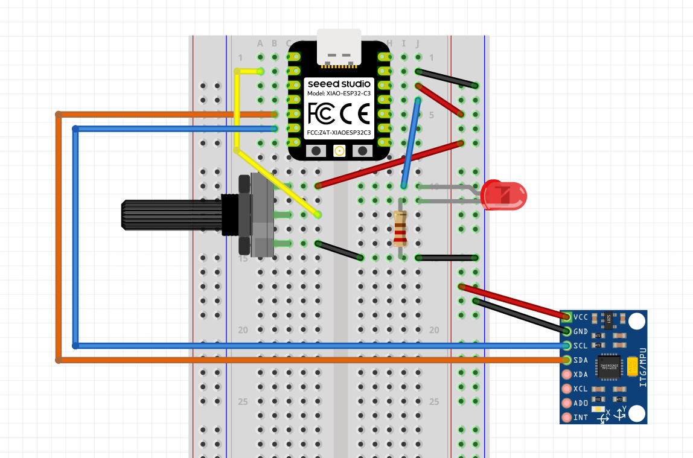
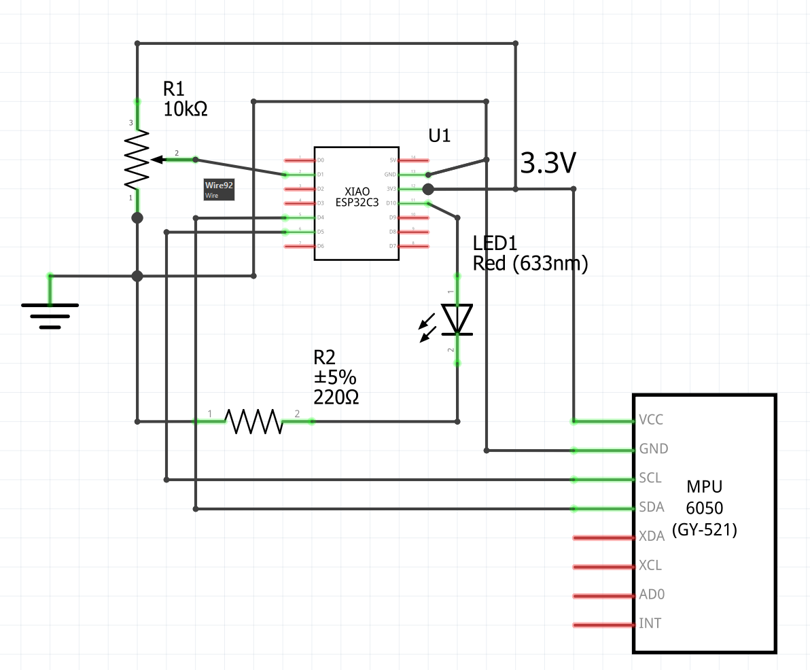

# 151. Exercice 9 : capteur MPU6050 avec ESPHome {#chapitre-exercice_mpu6050_esphome}

## 151.1 Travail demandé {#fiche-travail_demande}

Brancher un module MPU6050 au XIAO ESP32-C3 et exposer ses mesures dans Home Assistant avec ESPHome. L'exercice porte sur l'accéléromètre et le gyroscope; le LCD est présenté dans le contenu du cours, mais ne fait pas partie de cet exercice.

Vérifier le modèle exact du module, son brochage, sa tension d'alimentation et ses niveaux logiques avant de le brancher. Les modules de dérivation ne sont pas tous identiques. Ne jamais appliquer 5 V à une entrée du ESP32-C3 et ne jamais laisser SDA ou SCL être tirées à 5 V.


1. Copier la configuration actuelle de l'appareil et relever les broches déjà utilisées. Retirer le lecteur de température.
Consulter la fiche technique ou la documentation du module pour repérer `VCC` (ou `VIN`), `GND`, `SDA`, `SCL` et, si elle est accessible, `AD0`.
1. Hors tension, relier la masse du module à la masse du XIAO ESP32-C3. Alimenter le module selon sa documentation. Relier SDA à `GPIO6` et SCL à `GPIO7` si ces broches sont libres; sinon, choisir des broches compatibles et les déclarer de la même façon dans ESPHome. Vérifier que les résistances de rappel du bus sont compatibles avec les signaux 3,3 V du ESP32-C3.
1. Ajouter ou compléter la section `i2c:` dans le YAML, en activant temporairement le balayage :

   ```yaml
   i2c:
     sda: GPIO6
     scl: GPIO7
     scan: true
   ```





1. Compiler, installer le micrologiciel et redémarrer l'appareil. Lire les journaux ESPHome pour relever l'adresse du module. L'adresse habituelle est `0x68`; elle peut être `0x69` selon l'état de la broche `AD0`. Le balayage indique qu'une adresse répond, mais ne confirme pas à lui seul que le capteur fonctionne correctement.
1. Ajouter les capteurs MPU6050 sous la section `sensor:` existante. Remplacer l'adresse par celle relevée dans les journaux. Ne pas créer un deuxième bloc `sensor:` ou `i2c:` s'il en existe déjà un :

   ```yaml
   sensor:
     - platform: mpu6050
       address: 0x68
       update_interval: 1s
       accel_x:
         name: "MPU6050 Accélération X"
       accel_y:
         name: "MPU6050 Accélération Y"
       accel_z:
         name: "MPU6050 Accélération Z"
       gyro_x:
         name: "MPU6050 Vitesse angulaire X"
       gyro_y:
         name: "MPU6050 Vitesse angulaire Y"
       gyro_z:
         name: "MPU6050 Vitesse angulaire Z"
       temperature:
         name: "MPU6050 Température"
   ```

1. Compiler et installer la nouvelle configuration. Dans Home Assistant, vérifier que les entités des trois axes d'accélération, des trois axes du gyroscope et de la température apparaissent.
1. Garder le module immobile, puis l'incliner lentement dans plusieurs directions. Observer la variation de l'accélération selon les axes. Faire ensuite tourner doucement le module et observer les mesures du gyroscope; à l'arrêt, elles devraient revenir près de zéro.
1. Noter les observations et expliquer la différence entre accélération et vitesse angulaire. L'accéléromètre mesure aussi l'effet de la gravité; les valeurs ne donnent pas à elles seules une orientation complète ou un mouvement sans ambiguïté.
1. Vérifier les journaux et les entités après les essais. Si aucune adresse n'est trouvée, couper l'alimentation et vérifier SDA, SCL, la masse commune, l'alimentation, les broches configurées et les niveaux logiques. Après toute correction, redémarrer et consulter de nouveau les journaux.

## Remise

Remettre la configuration YAML sans secrets, un schéma indiquant les broches, les tensions et le modèle du module, l'adresse I²C détectée, ainsi qu'une capture ou une description des mesures observées lors de l'inclinaison et de la rotation.

## Critères de réussite

* Le module est branché selon sa documentation et les lignes I²C respectent les niveaux logiques du XIAO ESP32-C3.
* ESPHome détecte l'adresse du module au démarrage et cette adresse est utilisée dans sa configuration.
* Les trois axes d'accélération, les trois axes du gyroscope et la température sont publiés comme entités dans Home Assistant.
* Les mesures réagissent à l'inclinaison et à la rotation du module, et les observations distinguent accélération et vitesse angulaire.
* La configuration et le schéma remis correspondent au montage réel et ne contiennent aucun secret.
