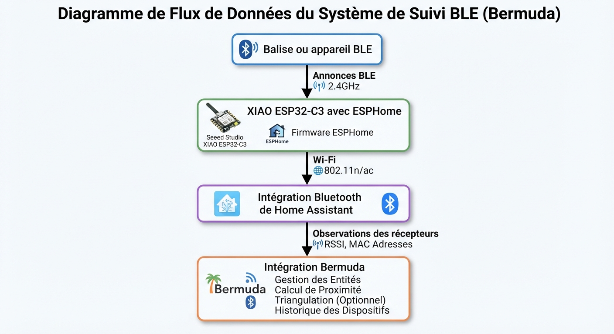
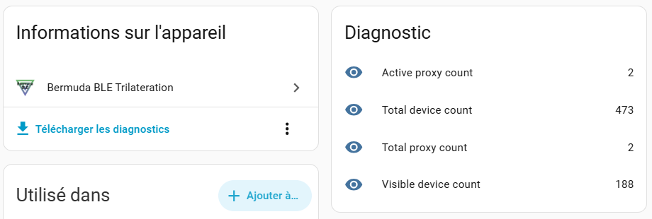
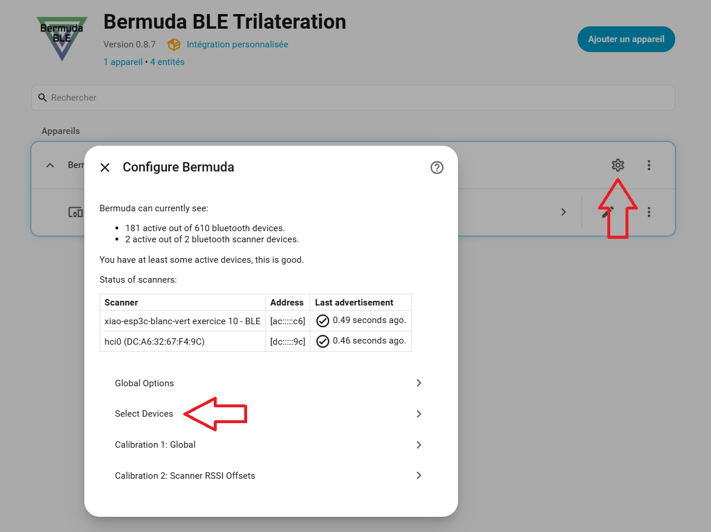

# 152. Bluetooth LE, proxy ESPHome et Bermuda {#chapitre-bluetooth_le_esphome}

## 152.1 Bluetooth classique et Bluetooth Low Energy

Bluetooth classique et Bluetooth Low Energy (BLE) sont deux modes de communication sans fil de la famille Bluetooth. Le Bluetooth classique sert notamment aux échanges continus avec des écouteurs ou des haut-parleurs. Le BLE est conçu pour communiquer à faible consommation; des capteurs et des balises peuvent y diffuser périodiquement de petites annonces.

Une annonce BLE (*advertisement*) est une courte transmission que des récepteurs à proximité peuvent écouter. Elle peut contenir un identifiant ou des données de service, mais pas nécessairement le nom de l'appareil. Écouter ces annonces ne demande généralement ni pairage ni connexion active. Cependant, tous les appareils Bluetooth ne diffusent pas des annonces BLE repérables en permanence.

Certains appareils utilisent des adresses aléatoires ou modifient leur identifiant afin de protéger la vie privée de leur utilisateur. Ils peuvent alors apparaître sous plusieurs identifiants, ou ne pas être reconnus comme le même appareil par une intégration de suivi. Pour un exercice reproductible, privilégier une balise BLE compatible dont l'identifiant est stable.

## 152.2 Étendre la réception avec un proxy Bluetooth ESPHome

Home Assistant peut recevoir des données BLE par son adaptateur Bluetooth local ou par des récepteurs distants. Un proxy Bluetooth ESPHome utilise le BLE du microcontrôleur pour écouter les appareils à proximité et transmettre les observations à Home Assistant par le réseau Wi-Fi :



Le proxy étend la portée de réception de Home Assistant; il ne transforme pas un appareil BLE en appareil Wi-Fi et ne rend pas tous les appareils contrôlables. Les intégrations Home Assistant déterminent ensuite quelles données elles peuvent interpréter.

ESPHome utilise `esp32_ble_tracker` pour écouter les annonces BLE et `bluetooth_proxy` pour les transmettre à Home Assistant. Les deux composants sont requis :

```yaml
esp32_ble_tracker:

bluetooth_proxy:
  active: false
```

`active: false` désactive les connexions BLE actives, mais le proxy continue de transmettre les annonces reçues. C'est suffisant pour observer des annonces et faire l'exercice de présence; cela ne permet pas à Home Assistant d'établir des connexions GATT actives par ce proxy. Ne pas confondre cette option avec le mode d'écoute de `esp32_ble_tracker`.

Ajouter ces composants à la configuration existante, sans créer un deuxième bloc de même nom. Compiler, installer le micrologiciel et vérifier les journaux ESPHome. 

Après le redémarrage, Home Assistant doit voir l'appareil ESPHome ainsi que le proxy comme récepteur Bluetooth. Dans **Paramètres > Appareils et services > Bluetooth**, vérifier que le récepteur est disponible et que des appareils à proximité sont détectés.

!!! warning

    L'activation de BLE augmente l'utilisation de la mémoire de l'ESP32. À la première installation de `esp32_ble_tracker`, ESPHome peut demander une nouvelle partition du micrologiciel; prévoir une installation USB plutôt qu'une mise à jour OTA. Une fois la nouvelle partition installée, les mises à jour OTA peuvent reprendre si elles fonctionnent normalement.

## 152.3 Localisation par pièce (area) avec Bermuda

Bermuda est une intégration personnalisée de Home Assistant qui utilise les observations de récepteurs Bluetooth pour estimer dans quelle **pièce (area)** se trouve un appareil BLE. Pour une estimation par pièce, il faut plusieurs récepteurs, idéalement placés dans des pièces distinctes et affectés aux pièces correspondantes dans Home Assistant. Un seul proxy peut détecter une balise et mesurer son signal, mais ne permet pas de comparer plusieurs pièces.

Bermuda compare notamment l'intensité du signal reçu (RSSI) par les différents récepteurs. Le RSSI est exprimé en dBm : une valeur moins négative correspond généralement à un signal plus fort. Il ne donne pas une distance exacte. Les murs, les personnes, l'orientation de la balise, les réflexions du signal et l'emplacement du proxy modifient la mesure. L'affectation à une pièce est donc une estimation qui peut varier, pas un système de positionnement précis.

Pour mettre en place Bermuda :

1. Dans Home Assistant, installer Bermuda depuis **Paramètres > Marketplace**, puis redémarrer Home Assistant si demandé.
1. Ajouter **Bermuda BLE Trilateration** dans **Paramètres > Appareils et services > Ajouter une intégration**.
1. Affecter chaque proxy à la pièce (area) correspondante dans Home Assistant. Vérifier cette affectation dans les paramètres de l'appareil.
1. Ouvrir la configuration de Bermuda et choisir un appareil ou une balise BLE compatible à suivre (*Select Devices*).
1. Vérifier les entités créées par Bermuda, par exemple la pièce estimée et la distance. Les noms et les capteurs disponibles dépendent de la version et de l'appareil.





L'installation de Bermuda et le suivi d'un appareil sont deux opérations distinctes : le fait qu'un appareil apparaisse dans Bluetooth ne signifie pas automatiquement qu'il est sélectionné dans Bermuda. Pour des appareils qui utilisent des adresses privées, consulter la documentation de Bermuda et l'intégration **Private BLE Device** de Home Assistant.

### Utiliser l'application Home Assistant Android comme balise

L'application Home Assistant Companion pour Android peut diffuser un iBeacon BLE. Dans l'application, ouvrir **Paramètres > Companion app > Manage sensors > Bluetooth sensors > BLE Transmitter**, activer le capteur et démarrer la transmission. Les réglages permettent notamment de choisir l'identifiant iBeacon (UUID, majeur et mineur), la puissance et le mode de transmission. L'identifiant transmis est aussi indiqué dans les attributs du capteur.

Le téléphone diffuse alors un identifiant BLE que les proxys ESPHome à proximité détectent comme un iBeacon, et non comme un appareil Home Assistant. Il n'est pas nécessaire d'associer l'application Companion au Home Assistant de l'équipe pour que les proxys reçoivent ses annonces. Ce n'est pas une transmission des capteurs du téléphone par Wi-Fi. Choisir ensuite l'iBeacon détecté dans Bermuda. Cette fonction est documentée pour Android; l'application Companion pour iOS ne propose pas ce capteur BLE Transmitter dans sa liste actuelle.

La transmission régulière peut réduire l'autonomie, particulièrement à puissance élevée. Pour la démonstration, utiliser un téléphone de test autorisé, garder la transmission active pendant les mesures et la désactiver après l'exercice. Comme pour toute balise, un seul proxy permet d'observer la réception du signal, mais plusieurs proxys associés à des pièces différentes sont nécessaires pour estimer une pièce.

## 152.4 Considérations de confidentialité

La détection BLE peut révéler la présence et les déplacements d'un appareil. Pour les démonstrations, utiliser une balise de cours ou un appareil dont la personne propriétaire a explicitement accepté le suivi. Ne pas enregistrer ou suivre les téléphones des autres personnes sans leur accord. Supprimer ensuite les appareils de test qui n'ont plus à être suivis.

## Références

* [ESP32 BLE Tracker ESPHome](https://esphome.io/components/esp32_ble_tracker/)
* [Bluetooth Proxy ESPHome](https://esphome.io/components/bluetooth_proxy/)
* [Intégration Bluetooth Home Assistant](https://www.home-assistant.io/integrations/bluetooth/)
* [Bermuda : dépôt et documentation officielle](https://github.com/agittins/bermuda)
* [Private BLE Device Home Assistant](https://www.home-assistant.io/integrations/private_ble_device/)
* [Capteurs de l'application Home Assistant Companion, dont BLE Transmitter](https://companion.home-assistant.io/docs/core/sensors/#bluetooth-sensors)
