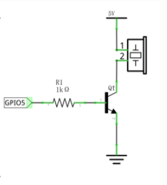

# 154. Buzzer passif et mélodies RTTTL avec ESPHome {#chapitre-buzzer_passif_rtttl_esphome}

## 154.1 Buzzer actif et buzzer passif

Un buzzer actif contient un oscillateur : lorsqu'il reçoit son alimentation, il produit généralement un son d'une hauteur fixe. Un buzzer passif, comme un transducteur piézoélectrique, ne contient pas cet oscillateur. Il faut lui envoyer un signal périodique pour le faire vibrer. La fréquence du signal détermine principalement la hauteur entendue : une fréquence plus élevée produit une note plus aiguë.

Une sortie PWM commute rapidement entre les niveaux bas et haut. Pour produire une note, on règle sa fréquence dans la plage audible. Il ne faut pas confondre la **fréquence**, qui détermine la hauteur, et le **rapport cyclique**, qui décrit la fraction du temps où le signal est à l'état haut. Le composant `rtttl` d'ESPHome utilise une sortie compatible pour jouer une mélodie monophonique décrite en RTTTL (*Ring Tone Text Transfer Language*).

## 154.2 Jouer une mélodie RTTTL

Une chaîne RTTTL comporte trois parties séparées par des deux-points :

```text
nom:d=4,o=5,b=120:notes
```

* `nom` identifie la mélodie.
* `d` indique la durée par défaut des notes; `o` l'octave; `b` le tempo en battements par minute.
* La dernière partie énumère les notes. Par exemple, `c`, `d`, `e` et `g` sont des notes; `p` représente une pause. Une note peut aussi préciser sa durée ou son octave.

```text
exemple:d=4,o=5,b=120:c,8e6,g,p,g
```

Dans `8e6`, `8` précise une durée de croche et `6` l'octave de la note `e`. Ces valeurs remplacent les paramètres par défaut `d` et `o` uniquement pour cette note.

Dans ESPHome, la sortie *ledc* du ESP32 fournit le signal PWM. Le composant `rtttl` l'utilise pour produire les notes

```yaml
output:
  - platform: ledc
    pin: GPIO5
    id: sortie_buzzer

rtttl:
  output: sortie_buzzer
  id: melodie
  gain: 50%
```

Remplacer `GPIO5` par une broche compatible et libre sur le montage. Pour jouer une mélodie à partir d'une action, par exemple lors de l'appui sur un bouton déjà déclaré :

```yaml
on_press:
  then:
    - rtttl.play: "cours:d=4,o=5,b=120:c,e,g,p,g"
```

Si une mélodie joue déjà, l'arrêter avec `rtttl.stop` avant d'en lancer une autre. Le format RTTTL permet de changer le tempo, la durée et les notes sans réécrire le câblage ou la configuration de la sortie.

## 154.3 Commander le buzzer avec un transistor

Une broche GPIO du XIAO ESP32-C3 fournit un signal logique de 3,3 V et ne doit pas alimenter directement un composant qui demande une alimentation de 5 V ou un courant supérieur à ce que la broche peut fournir. Un transistor NPN peut servir d'interrupteur côté masse : le signal PWM commande sa base à travers une résistance, tandis que le courant du buzzer circule entre l'alimentation de 5 V, le buzzer, le collecteur et l'émetteur du transistor. Le montage Freenove cité en référence utilise le transistor NPN S8050 fourni dans son kit; vérifier le marquage et le brochage du composant réel avant le câblage.



La masse du XIAO ESP32-C3 et celle de l'alimentation de 5 V doivent être communes pour que le signal de commande ait une référence partagée. Le 5 V du buzzer ne doit jamais être raccordé à une broche GPIO. Le branchement illustré est un interrupteur NPN côté masse; le brochage des pattes varie selon le modèle de transistor, il faut donc le vérifier dans sa fiche technique avant de le monter.

!!! warning

    Couper l'alimentation avant de modifier le câblage. Vérifier la tension nominale et le courant du buzzer, les limites du transistor et la valeur de la résistance de base. La résistance de 1 kΩ montrée dans certains montages de trousses n'est pas universelle. En cas de doute, faire vérifier le montage avant de l'alimenter.

## Références

* [Composant RTTTL ESPHome](https://esphome.io/components/rtttl/)
* [Sortie LEDC ESPHome pour ESP32](https://esphome.io/components/output/ledc/)
* [Exemple Freenove : buzzer et transistor](https://docs.freenove.com/projects/fnk0075/en/latest/fnk0075/codes/Python/7_Buzzer.html)
