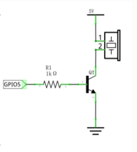
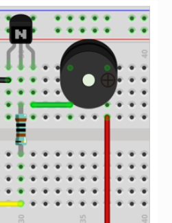

# 155. Exercice 11 : buzzer passif, transistor et mélodie RTTTL {#chapitre-exercice_buzzer_passif_rtttl_esphome}

## 155.1 Travail demandé {#fiche-travail_demande}

Brancher un buzzer passif alimenté en 5 V au XIAO ESP32-C3 à l'aide d'un transistor NPN, puis utiliser ESPHome et Home Assistant pour saisir et jouer une courte mélodie RTTTL. La broche GPIO commande seulement la base du transistor; elle ne fournit pas le courant d'alimentation du buzzer.

Avant le montage, vérifier le modèle du buzzer, la tension et le courant requis, le brochage du transistor et la valeur de la résistance de base. Le circuit ci-dessous est un interrupteur NPN côté masse; les broches du transistor ne sont pas disposées de la même façon sur tous les modèles.

### Matériel

* XIAO ESP32-C3 configuré avec ESPHome et connecté à Home Assistant;
* buzzer passif compatible avec une alimentation de 5 V;
* transistor NPN S8050 fourni dans le kit Freenove (vérifier le marquage et le brochage du composant réel);
* résistance de base adaptée au transistor et au montage (par exemple, la résistance de 1 kΩ prévue dans la trousse, si elle convient aux composants utilisés);
* alimentation de 5 V appropriée, fils et plaque d'essai.

### Branchement

Effectuer le câblage hors tension. Utiliser une broche libre compatible avec la sortie LEDC; l'exemple ci-dessous utilise `GPIO5`.





1. Relier la borne positive du buzzer à l'alimentation de 5 V et sa borne négative au collecteur du transistor.
1. Relier l'émetteur à la masse de l'alimentation. Relier également cette masse à `GND` du XIAO ESP32-C3.
1. Relier la broche GPIO choisie à la base du transistor **à travers la résistance de base**.
1. Vérifier le brochage du transistor à partir de sa fiche technique et vérifier qu'aucun fil du buzzer ou de l'alimentation de 5 V n'est relié directement à une broche GPIO.

!!! warning

    Ne jamais appliquer 5 V à une entrée ou sortie du XIAO ESP32-C3. Ne pas utiliser une broche GPIO pour alimenter le buzzer. Si l'alimentation de 5 V est distincte de celle du XIAO, les masses doivent être communes; ne pas relier ensemble deux sorties positives de 5 V.

## 155.2 Configuration ESPHome

Ajouter la sortie LEDC et le composant RTTTL à la configuration existante. Ne pas créer un deuxième bloc `output:` ou `rtttl:` s'il y en a déjà un. Remplacer la broche par celle réellement utilisée si nécessaire.

```yaml
output:
  - platform: ledc
    pin: GPIO5
    id: sortie_buzzer

rtttl:
  output: sortie_buzzer
  id: melodie
  gain: 50%
```

La chaîne d'exemple contient les paramètres RTTTL et une suite de notes séparés par des deux-points. Elle peut être remplacée par une courte mélodie compatible.

## 155.3 Saisir une mélodie depuis Home Assistant

Créer une entité texte ESPHome modifiable et un bouton ESPHome. Après avoir ajouté ou actualisé l'intégration ESPHome dans Home Assistant, ces entités seront exposées dans Home Assistant : le champ texte permet de saisir la chaîne RTTTL et le bouton démarre sa lecture. Les entités texte ESPHome nécessitent Home Assistant 2023.11 ou une version ultérieure.

Ajouter ces sections à la configuration existante et compléter comme nécessaire. Ne pas créer un deuxième bloc `text:` ou `button:` s'il y en a déjà un.

```yaml
text:
  - platform: template
    name: "Mélodie RTTTL"
    id: rtttl_saisie
    mode: text
    optimistic: true
    initial_value: "cours:d=4,o=5,b=120:c,e,g,p,g"
    max_length: 255

button:
  - platform: template
    name: "Jouer la mélodie RTTTL"
    on_press:
      - rtttl.play:
          rtttl: !lambda **à compléter**
```

Dans Home Assistant, ajouter l'entité **Mélodie RTTTL** et le bouton **Jouer la mélodie RTTTL** à un tableau de bord. Saisir une chaîne valide dans le champ texte, valider la saisie, puis appuyer sur le bouton. Le bouton joue la dernière valeur reçue par l'ESP32. Essayer une note comme `8e6` dans une séquence et vérifier le résultat.

1. Enregistrer une copie de la configuration actuelle et vérifier que `GPIO5` est libre.
1. Monter le circuit hors tension, puis faire vérifier le brochage, les masses communes et la résistance de base avant de brancher l'alimentation.
1. Ajouter la configuration LEDC et RTTTL, l'entité texte et le bouton template. Conserver les autres sections du YAML et éviter les clés répétées.
1. Compiler le micrologiciel. Corriger les erreurs YAML ou de configuration avant de l'installer.
1. Installer le micrologiciel et consulter les journaux ESPHome. Dans Home Assistant, vérifier que les deux nouvelles entités apparaissent et ajouter un champ texte et un bouton au tableau de bord.
1. Saisir une chaîne RTTTL dans Home Assistant et appuyer sur **Jouer la mélodie RTTTL**. Vérifier que le buzzer joue la mélodie.
1. Modifier le gain si nécessaire pour obtenir un volume audible sans saturer le buzzer. 
1. Modifier le tempo ou les notes dans la chaîne RTTTL depuis Home Assistant et comparer le résultat sans recompiler le micrologiciel. Noter la différence entre changer la fréquence des notes et changer leur durée ou le tempo.

### Dépannage

* **Aucun son :** vérifier qu'il s'agit d'un buzzer passif, que l'alimentation de 5 V est présente, que les masses sont communes et que les pattes du transistor correspondent à sa fiche technique.
* **La compilation échoue :** vérifier l'indentation YAML, les identifiants `sortie_buzzer` et `melodie`, ainsi que l'absence de blocs `output:` ou `rtttl:` dupliqués.
* **Le son reste fixe ou la mélodie ne varie pas :** vérifier que la sortie utilise `platform: ledc`, que l'action appelle `rtttl.play` et que la chaîne RTTTL est valide.
* **Le transistor ou le buzzer chauffe, ou l'ESP32 redémarre :** couper immédiatement l'alimentation et demander de l'aide. Vérifier la tension, le courant, le brochage et l'adéquation du transistor; ne pas poursuivre les essais à l'aveugle.

## Remise

Remettre la configuration ESPHome sans secrets, un schéma du montage indiquant les broches du transistor, la résistance de base, les masses et l'alimentation de 5 V, ainsi que la chaîne RTTTL utilisée. Expliquer brièvement le rôle du transistor et la différence entre fréquence et tempo.

## Critères de réussite

* Le buzzer passif est alimenté en 5 V au travers du circuit de commutation NPN; aucune broche GPIO n'est reliée au 5 V.
* Le transistor est câblé selon son brochage et sa masse est commune à celle du XIAO ESP32-C3.
* L'entité texte RTTTL et le bouton ESPHome apparaissent dans Home Assistant; le bouton joue la chaîne RTTTL saisie dans l'entité texte.
* La remise contient la configuration, le schéma et une explication correcte du signal PWM et du rôle du transistor.

## Références

* [Composant RTTTL ESPHome](https://esphome.io/components/rtttl/)
* [Sortie LEDC ESPHome pour ESP32](https://esphome.io/components/output/ledc/)
* [Exemple Freenove : buzzer et transistor](https://docs.freenove.com/projects/fnk0075/en/latest/fnk0075/codes/Python/7_Buzzer.html)
